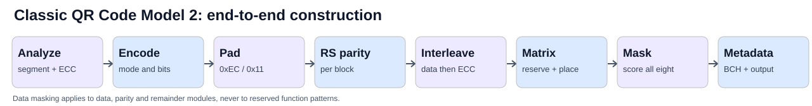
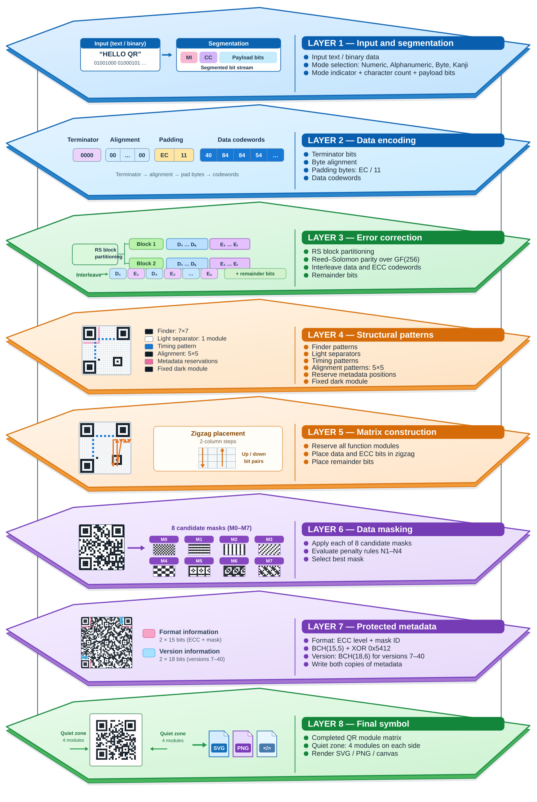

# QR Code Generator

## Presentation

QRgen is a standalone, browser-based construction set for generating version 2 QR codes. Its purpose is to make the underlying construction process transparent and comprehensive by presenting the encoder as eight distinct stages. Each stage builds on the previous stage, and the stages can be tested independently in the QR Code Lab. Even though we are demonstrating each step in easy readable vanilla JavaScript, this approach helps explain the formulas and algorithms involved in turning input data into a QR code, without too much focus on programming language specifics.

## Pipeline summary

The infographic below shows the same eight stages in order, from the input data to the completed QR symbol.

**Layer 1 — Input and segmentation.** The input text or binary data is divided into segments and assigned an encoding mode (Numeric, Alphanumeric, Byte, or Kanji). Each segment becomes a bit stream containing a mode indicator, a character count, and the encoded payload.

**Layer 2 — Data encoding.** Terminator bits finish the message, zero bits align it to byte boundaries, and alternating padding bytes (`0xEC` and `0x11`) fill the available capacity. The result is the required sequence of data codewords.

**Layer 3 — Error correction.** The data codewords are partitioned into Reed–Solomon blocks as required by the QR version and error-correction level. Parity codewords are calculated over GF(256); data and error-correction codewords are then interleaved, with remainder bits accounted for in the final stream.

**Layer 4 — Structural patterns.** The matrix receives its fixed patterns: finder patterns and light separators, timing and alignment patterns, and the fixed dark module. Positions for format and version metadata are reserved where applicable.

**Layer 5 — Matrix construction.** After all function modules have been reserved, the encoded data, error-correction codewords, and remainder bits are placed into the remaining cells using the prescribed zigzag pattern.

**Layer 6 — Data masking.** Eight candidate masks are applied to the data modules. Each result is scored against penalty rules N1–N4, and the mask producing the lowest penalty is selected.

**Layer 7 — Protected metadata.** The error-correction level and chosen mask identifier are encoded into BCH-protected format information, combined with the specified XOR mask (`0x5412`), and written in both reserved locations. BCH-protected version information is also added for versions 7–40 (not for version 2).

**Layer 8 — Final symbol.** The completed QR module matrix is surrounded by a quiet zone four modules wide on every side. The final symbol can then be rendered as SVG, PNG, or on an HTML canvas.

## Documentation

The [QR Code Model construction guide](docs/QR_CODE_CONSTRUCTION.md) provides a comprehensive implementation reference, including the alignment-pattern layouts for all 40 versions, 160 error-correction configurations, and BCH-encoded format and version information.

## QR Code Lab

## Tools and references

- [Layer 1 — Input and Segmentation Lab](tools/layer1_encoder.html) — fully offline HTML tool; mode selection, optimized segments and exact payload bitstream.
- [QR padding calculator](https://flyingzebra.github.io/QRgen/tools/padding_calculator.html)
- [QR code tutorial: format and version information](https://www.thonky.com/qr-code-tutorial/format-version-information)
- [Online BCH code generator](http://www.ece.unb.ca/cgi-bin/tervo/bch.pl)
- [LaTeX rendering service](https://latex.codecogs.com)
