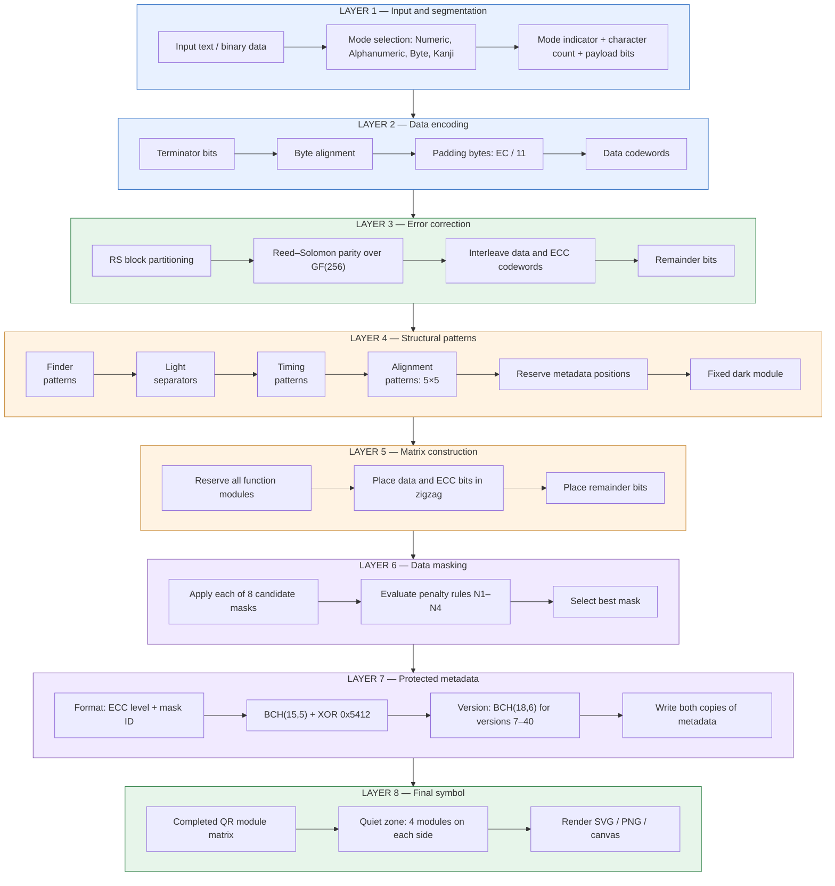

# QR generator

## Complete documentation

[QR Code Model construction guide](docs/QR_CODE_CONSTRUCTION.md) — comprehensive implementation reference, all 40 alignment layouts, 160 ECC configurations, and all BCH format/version words.

<a href="https://flyingzebra.github.io/QR_generator/tools/padding_calculator.html">QR padding calculator</a>

https://www.thonky.com/qr-code-tutorial/format-version-information

# reed-solomon

k = unencoded message length  
n = encoded message length  
m = symbol size in bits  
d = hamming distance  
t = number of correctable symbols

d = 

t = 
= 

cylclic codes = any circular bit-shif of a codeword is another valid codeword  
liner codes = any sum of two valid codewords is is another valid codeword  

cyclic codes are represented as polynomials, and for the calculations we need to do, we start with writing the message as a polynomial.

example message:  
1011 =   
= 

convertion from message space to codeword space is achieved by:  
**multiplying** the message polynomial by a special **generator polynomial**

# BCH

online BCH code generator
http://www.ece.unb.ca/cgi-bin/tervo/bch.pl

# QR code calculation

https://www.thonky.com/qr-code-tutorial/format-version-information

---

https://latex.codecogs.com

