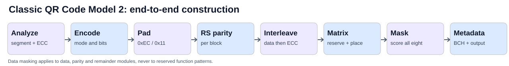
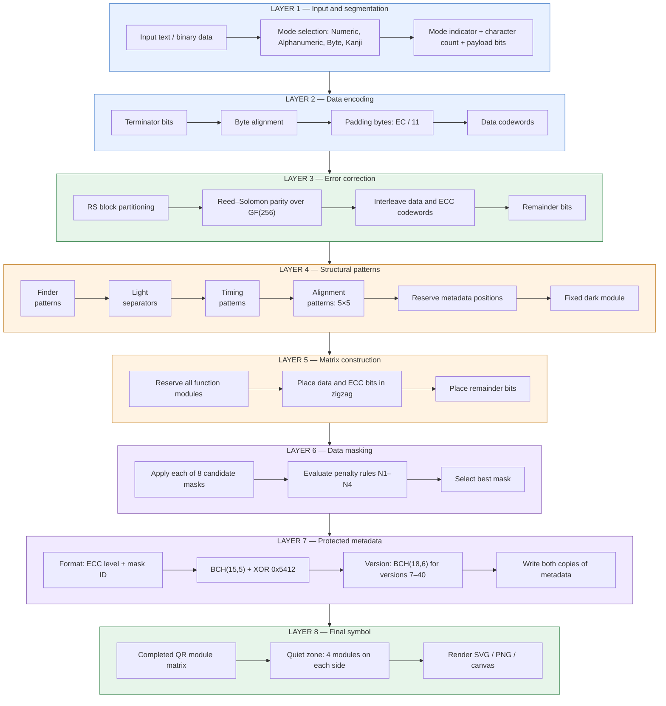
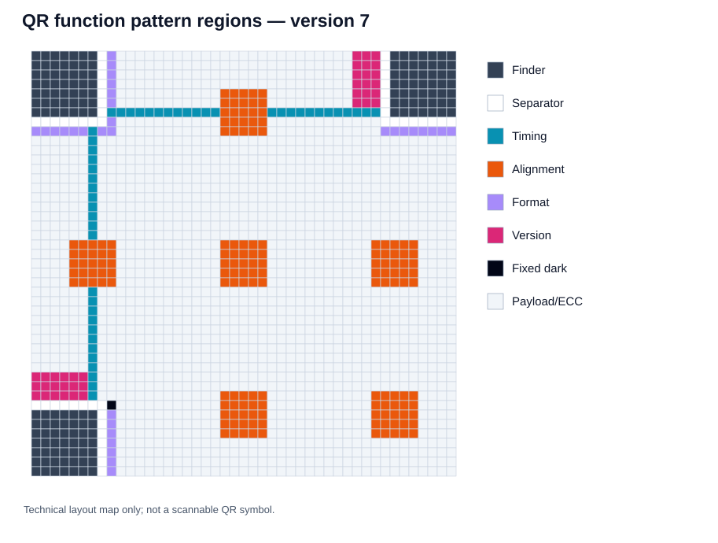
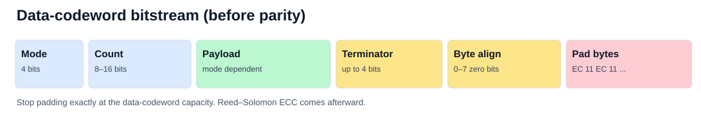
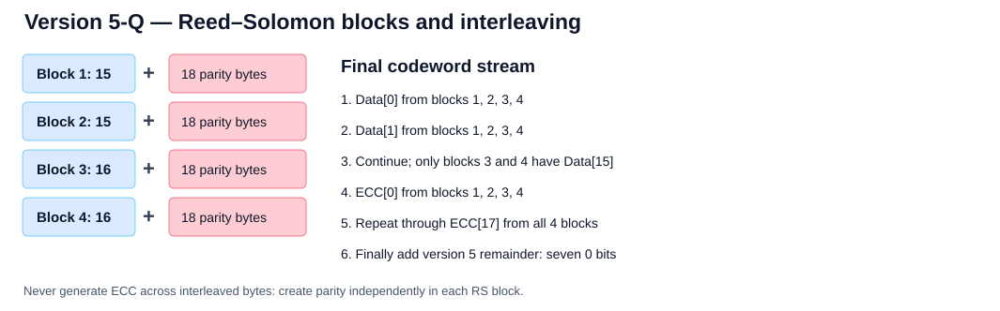
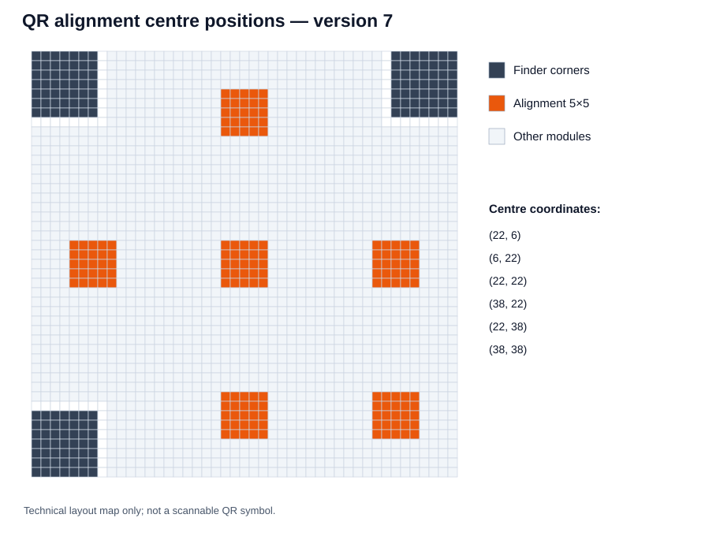
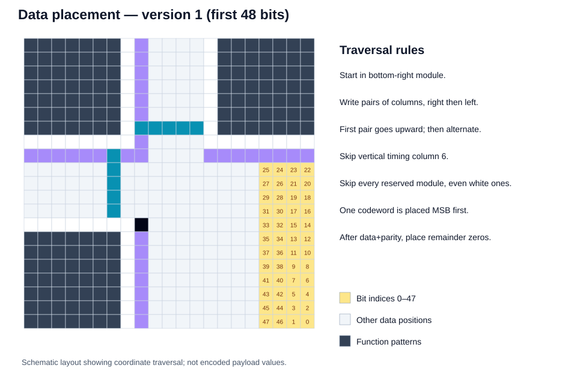
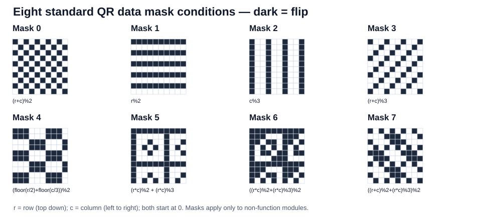
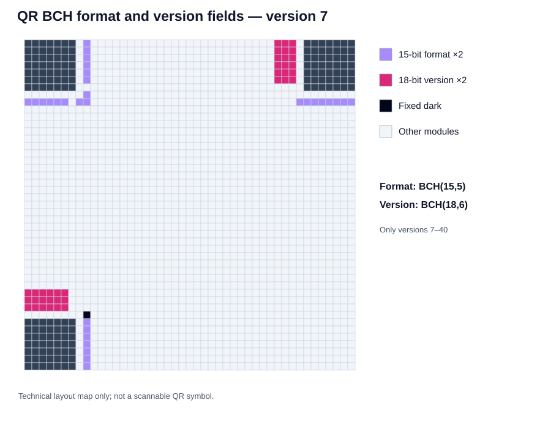

# Constructing a Classic QR Code (Model 2)

**An original, implementation-oriented reference for QR Code versions 1–40.** This document belongs to the [QR_generator](../README.md) repository and describes how to build a standard square QR symbol from scratch. It covers segmentation, data padding, Reed–Solomon ECC, matrix construction, alignment patterns, masking, BCH-protected metadata, rendering, and regression tests.

**Scope:** Conventional QR Code **Model 2** only (not Model 1, Micro QR, rMQR, proprietary color symbols, or full decoder implementation). The normative specification is ISO/IEC 18004:2024; follow that standard for formal conformance. This is newly written documentation, **not a copy** of Thonky's tutorial or images.

## Contents

1. [Encoding pipeline](#1-encoding-pipeline)
2. [Version, geometry, and QR anatomy](#2-version-geometry-and-qr-anatomy)
3. [Data modes and segments](#3-data-modes-and-segments)
4. [Choosing the version and ECC level](#4-choosing-the-version-and-ecc-level)
5. [Building the data bitstream](#5-building-the-data-bitstream)
6. [Reed–Solomon GF(256) parity](#6-reedsolomon-gf256-parity)
7. [Block partitioning and interleaving](#7-block-partitioning-and-interleaving)
8. [Function patterns and alignment positions](#8-function-patterns-and-alignment-positions)
9. [Bit placement and remainder bits](#9-bit-placement-and-remainder-bits)
10. [The eight data masks](#10-the-eight-data-masks)
11. [BCH format information](#11-bch-format-information)
12. [BCH version information](#12-bch-version-information)
13. [Output rendering](#13-output-rendering)
14. [Worked V1-M example: HELLO WORLD](#14-worked-v1-m-example-hello-world)
15. [Implementation and regression checklist](#15-implementation-and-regression-checklist)
16. [Appendix A: geometry and alignment (all 40 versions)](#appendix-a-geometry-and-alignment-all-40-versions)
17. [Appendix B: ECC configurations (all 160)](#appendix-b-ecc-configurations-all-160)
18. [Appendix C: all 32 format words](#appendix-c-all-32-format-words)
19. [Appendix D: version words 7–40](#appendix-d-version-words-740)
20. [References](#references)

## 1. Encoding pipeline






A correct Model 2 encoder follows this sequence:

1. Classify the input and select **numeric, alphanumeric, byte, Kanji, or mixed segments**. Choose an error-correction level.
2. Calculate the encoded **bit length**, including mode indicators, character-count fields, and any ECI or FNC1 headers. Select a version with sufficient data capacity.
3. Encode each segment into a bitstream. Add terminator bits, byte-boundary zeros, then alternating **`0xEC`, `0x11` padding codewords** until exactly the correct number of data bytes is present.
4. Partition the data bytes into the prescribed **Reed–Solomon blocks** and generate ECC bytes independently for each block.
5. Interleave *data* bytes across blocks, then interleave *parity* bytes. Add any final **remainder zero bits**.
6. Reserve function patterns in a version-sized module matrix. Place the message bits in the remaining modules using a **two-column zig-zag**.
7. Apply all **eight QR data masks** to *data-region modules only*, score each candidate, and retain a minimum-penalty mask.
8. Insert **BCH-protected format information**, plus **version information** from version 7 onward; render modules with a four-module quiet zone.

Use two arrays throughout: `modules[y][x]` for dark/light state and `reserved[y][x]` for function/metadata occupancy. A white function module **is still reserved**.

## 2. Version, geometry, and QR anatomy

For version **v** (1 through 40), the symbol width and height are `N = 17 + 4*v` modules. Version 1 is **21×21**; version 40 is **177×177**. Matrix coordinates are **zero-based**: x increases to the right, y downward.

| Element | Description / placement |
|---|---|
| Finder | Three nested 7×7 patterns at top-left, top-right, bottom-left |
| Separator | One light module between finder and adjacent encoding region |
| Timing | Alternating dark/light modules along row 6 and column 6 |
| Alignment | 5×5 targets at version-dependent coordinates, starting with version 2 |
| Data/ECC | Non-reserved cells, filled by zig-zag placement |
| Format | Two redundant 15-bit BCH-protected fields for ECC level + mask number |
| Version | Two redundant 18-bit BCH-protected fields for versions 7–40 |
| Fixed dark | Always dark at `(x=8, y=4*v+9)` = `(8, N-8)` |
| Quiet zone | At least four light modules on every side, outside the N×N symbol |



Notice that alignment patterns are not at a fixed periodic spacing. They must be calculated or looked up per version.

## 3. Data modes and segments

An ordinary segment begins with **four mode bits**, then a **mode-specific character-count field**, then the encoded data bits. Mixed messages may use multiple segments to improve efficiency.

| Mode | Four-bit indicator | Encoding | Payload bits |
|---|---|---|---|
| Numeric | `0001` | Groups of three decimal digits | 10 bits/3; remainder 2 → 7 bits; remainder 1 → 4 bits |
| Alphanumeric | `0010` | Pairs from the standard 45-character alphabet | 11 bits/pair; last single → 6 bits |
| Byte | `0100` | Explicit sequence of bytes | 8 bits/byte |
| Kanji | `1000` | Eligible double-byte Shift-JIS characters | 13 bits/character |
| ECI | `0111` | Character-set designation | Variable-length ECI assignment, no count field |
| Structured append | `0011` | Position, total count, parity across symbols | 16 bits after the indicator |
| FNC1 (first) | `0101` | GS1-oriented interpretation | No character count |
| FNC1 (second) | `1001` | Industry-specific interpretation | Additional indicator |

The alphanumeric alphabet in numeric value order is:

`0123456789ABCDEFGHIJKLMNOPQRSTUVWXYZ $%*+-./:`

For a pair of alphanumeric values **a**, **b**, append the 11-bit representation of `45*a+b`. A final single is a six-bit value. Numeric digits must retain leading zeros through fixed-width encoding.

### Character-count field lengths

| Mode | Versions 1–9 | Versions 10–26 | Versions 27–40 |
|---|---:|---:|---:|
| Numeric | 10 | 12 | 14 |
| Alphanumeric | 9 | 11 | 13 |
| Byte | 8 | 16 | 16 |
| Kanji | 8 | 10 | 12 |

In **byte mode**, character count means **number of encoded bytes**, not JavaScript string length. For non-Latin characters, use a defined encoding and preferably an **ECI designator** (UTF-8 ECI assignment **26**) when interoperability demands an unambiguous character set.

**Kanji mode:** eligible Shift-JIS values `0x8140–0x9FFC` or `0xE040–0xEBBF` are reduced by `0x8140` or `0xC140` respectively. The reduced value is transformed into `highByte*0xC0 + lowByte`, encoded in 13 bits. Arbitrary Unicode characters cannot simply be fed to this mode.

### Segmentation algorithm

A compact encoder can start with one segment per input (numeric if possible, otherwise alphanumeric, otherwise byte). A better encoder uses dynamic programming to choose segment boundaries and minimize **header bits + payload bits**. Recalculate after entering a new character-count version band; the optimal segmentation can change at versions 10 and 27.

## 4. Choosing the version and ECC level

| ECC grade | Typical protection category | Approximate restoration capability |
|---|---|---:|
| L | Low | 7% |
| M | Medium | 15% |
| Q | Quartile | 25% |
| H | High | 30% |

These percentages are *general codeword restoration categories*, not guarantees that arbitrary physical damage covering that fraction of the image will scan. Higher ECC strength consumes payload capacity.

For a candidate version and level, calculate the total encoded segment size and require:

`segmentBits <= dataCodewords(version, eccLevel) * 8`

Count all mode indicators, count bits, ECI indicators and payload bits. Choose the smallest version that fits (or a larger one when visual size/robustness constraints warrant). A QR Version 40-L holds up to roughly 7,089 numeric digits, 4,296 alphanumeric characters, 2,953 byte-mode bytes, or 1,817 Kanji-mode characters for a single appropriate segment; mixed segments or ECI reduce these maxima.

All 160 data capacities are included in [Appendix B](#appendix-b-ecc-configurations-all-160).

## 5. Building the data bitstream



1. Append each segment's mode indicator and correctly sized character count (where applicable).
2. Append the corresponding bit-packed data (MSB first for every encoded integer).
3. If space remains, append up to **4 zero terminator bits** without exceeding data capacity.
4. Append 0–7 zeros to reach the next **8-bit boundary** (again, without exceeding data capacity).
5. Split bits into full bytes, then add alternating **`EC`, `11`, `EC`, `11`, ...** hex pad codewords until the exact data-codeword capacity is reached. Start with **`0xEC`**, regardless of previously encoded bytes.

```javascript
function padDataBits(segmentBits, dataCodewords) {
  const limit = dataCodewords * 8;
  if (segmentBits.length > limit) throw Error('Payload exceeds capacity');
  let bits = segmentBits + '0'.repeat(Math.min(4, limit - segmentBits.length));
  bits += '0'.repeat(Math.min((8 - bits.length % 8) % 8, limit - bits.length));
  const bytes = bits.match(/.{8}/g)?.map(v => parseInt(v, 2)) || [];
  for (let i = 0; bytes.length < dataCodewords; i++)
    bytes.push(i % 2 === 0 ? 0xEC : 0x11);
  return bytes;
}
```

**Do not confuse** pad **codewords** (`EC` / `11`, before RS) with **remainder bits** (zero bits after interleaving, not codewords).

## 6. Reed–Solomon GF(256) parity

A classic QR Code uses **real Reed–Solomon error correction** for payload codewords, working with eight-bit symbols over `GF(256)`. The field's irreducible polynomial is:

`x^8 + x^4 + x^3 + x^2 + 1` (binary `1_0001_1101`, hexadecimal **`0x11D`**).

Field addition/subtraction is bytewise XOR. Multiplication is polynomial multiplication reduced modulo `0x11D`. With primitive element `alpha = 0x02`, a block requiring **e** parity codewords uses generator polynomial:

`g(x) = (x - alpha^0) * (x - alpha^1) * ... * (x - alpha^(e-1))`

In characteristic 2, subtraction is the same as addition. Treat the data bytes as coefficients from highest power to lowest, multiply by `x^e`, and take the remainder of polynomial division by `g(x)`. The **e-byte remainder** provides the RS ECC block. Correct up to `floor(e/2)` unknown wrong byte symbols in one block, or more generally satisfy `2*errors + knownErasures <= e` (within the decoder's correctable limits).

**Implementation requirements:** generator coefficients are elements of `GF(256)`, not ordinary integers; XOR all additions; reduce every multiplication; preserve byte order; compute each block **independently**. Appendix B defines how many ECC bytes and blocks to use.

## 7. Block partitioning and interleaving



For a version/level, let:

- **R** = total raw codewords (data + parity), from Appendix A;
- **B** = total number of RS blocks, from Appendix B;
- **e** = parity codewords **per block**, from Appendix B;
- **D** = data codeword capacity, from Appendix B.

Then group the data codewords into consecutive blocks using:

```text
shortBlockCount    = B - (R % B)
shortBlockTotalLen = floor(R / B)
shortBlockDataLen  = shortBlockTotalLen - e

First shortBlockCount blocks: shortBlockDataLen data bytes.
Remaining blocks:            shortBlockDataLen + 1 data bytes.
All blocks:                  e parity bytes each.
```

The short group comes first. No independent group table is needed; these formulas reconstruct the standard block groupings.

After calculating each block's parity, interleave as follows:

1. Take the first **data byte** of every block (in block order), then the second of every block, and so on; skip blocks when their data is exhausted.
2. Separately, take the first **ECC byte** of every block, then the second, continuing through parity position `e-1`.
3. Append **0–7 remainder zero bits** as prescribed by the version. Remainder bits are not part of RS data or parity.

For **version 5-Q**, there are **62 data bytes**, divided into blocks holding `15,15,16,16` data bytes. Every block generates **18 parity bytes**, giving **72 parity bytes** and **134 interleaved codewords**. Version 5 adds **7 remainder zero bits**, filling `134*8+7 = 1,079` non-function modules.

**Critical:** Never generate Reed–Solomon parity over the *interleaved* stream, and never concatenate complete data+ECC blocks as the final message.

## 8. Function patterns and alignment positions



Draw and **reserve** finders, separators, timing patterns, alignment patterns, format locations, version locations (if v≥7), and the fixed dark module *before* writing data bits.

A finder is 7×7 with dark outer ring, light 5×5 ring, and dark 3×3 centre, accompanied by a one-module white separator where it borders the encoding region. Timing is alternating, with the exposed horizontal part along `y=6` and vertical part along `x=6`.

An **alignment target** is 5×5: dark border, light 3×3 ring, dark centre. For version v≥2, calculate the exact centre list in [Appendix A](#appendix-a-geometry-and-alignment-all-40-versions), use it on both x and y axes, and omit three pairs where the target would overlap a finder: `(first,first)`, `(last,first)`, `(first,last)`.

Thus version 7 has centres `[6, 22, 38]` and **six actual alignment patterns**. A constant spacing of 12 modules is incorrect.

An equivalent coordinate algorithm is:

```javascript
function alignmentPositions(version) {
  if (version === 1) return [];
  const count = Math.floor(version / 7) + 2;
  const step = Math.floor((version * 8 + count * 3 + 5) / (count * 4 - 4)) * 2;
  const positions = Array(count);
  for (let i = count - 1, x = version * 4 + 10; i >= 1; --i, x -= step)
    positions[i] = x;
  positions[0] = 6;
  return positions;
}
```

## 9. Bit placement and remainder bits



Starting at bottom-right, visit columns in **two-column bands**, moving right-column-first then left-column at each row. Move upward for the rightmost band, downward for the next, upward for the next, etc. Skip column `x=6` (timing), and skip every reserved module. Write each data/ECC byte **most-significant bit first**. Then place zero-valued remainder bits.

```javascript
function dataPlacementCoordinates(version, reserved) {
  const n = 17 + 4 * version, result = [];
  for (let right = n - 1; right >= 1; right -= 2) {
    if (right === 6) right = 5;
    const upward = ((right + 1) & 2) === 0;
    for (let i = 0; i < n; i++) {
      const y = upward ? n - 1 - i : i;
      for (let side = 0; side < 2; side++) {
        const x = right - side;
        if (!reserved[y][x]) result.push([x, y]);
      }
    }
  }
  return result;
}
```

A must-have invariant for every version: **number of non-reserved placement cells = `8 * rawCodewords + remainderBits`**. Version 1 has 208 placement cells and 0 remainder bits; version 40 has 29,648 placement cells. If your count differs, check reserved **white** cells, format/version fields, and alignment overlaps.

## 10. The eight data masks



For each mask number, XOR a data/ECC/remainder module when the following expression equals **zero**. Let `r` be row (y), `c` column (x), both zero-based. **Do not apply these masks to reserved function or metadata regions.**

| Mask | Flip condition (zero result) |
|---:|---|
| 0 | `(r+c) % 2` |
| 1 | `r % 2` |
| 2 | `c % 3` |
| 3 | `(r+c) % 3` |
| 4 | `(floor(r/2)+floor(c/3)) % 2` |
| 5 | `(r*c)%2 + (r*c)%3` |
| 6 | `((r*c)%2 + (r*c)%3) % 2` |
| 7 | `((r+c)%2 + (r*c)%3) % 2` |

Test all eight candidates. For each, generate the corresponding **format information** and score the **complete symbol** (including function patterns and metadata), using the QR penalty conditions:

| Rule | Condition | Penalty |
|---|---|---|
| N1 | Run of ≥5 consecutive equal-color modules, horizontally or vertically | 3 for the fifth; +1 each additional module |
| N2 | Any 2×2 square of the same color | +3 |
| N3 | Finder-like 1:1:3:1:1 pattern with appropriate 4-module light context (rows or columns) | +40 per qualifying occurrence |
| N4 | Dark/light balance displaced from approximately 50% | +10 per 5-percentage-point step under the QR penalty rule |

The least-penalized mask wins (use a deterministic tie-breaker such as lowest ID). Formulas flip **data modules**, but penalty rules evaluate the **whole symbol**. Do not confuse data masks with the fixed **`0x5412` format-word XOR**.

## 11. BCH format information



The format field contains **5 information bits**: 2 bits for the ECC level and 3 for the selected mask (0–7). It is protected by **BCH(15,5)**, resulting in 15 bits, then XORed with a fixed 15-bit mask.

| ECC level | Format indicator bits |
|---|---|
| L | `01` |
| M | `00` |
| Q | `11` |
| H | `10` |

1. Set `data = (eccFormatBits << 3) | maskId` (5 bits).
2. Compute the 10-bit remainder of `(data << 10)` divided over **GF(2)** by generator polynomial **`0x537`** (`x^10+x^8+x^5+x^4+x^2+x+1`).
3. Form `((data << 10) | remainder) ^ 0x5412` (15 bits).
4. Write the result in **both** format areas in the exact bit-index order below.

```javascript
function formatWord(ecc, mask) {
  const levelBits = {L: 1, M: 0, Q: 3, H: 2}[ecc];
  if (levelBits === undefined || mask < 0 || mask > 7) throw Error('bad format');
  const data = (levelBits << 3) | mask;
  let rem = data;
  for (let i = 0; i < 10; i++) rem = (rem << 1) ^ ((rem >>> 9) * 0x537);
  return ((data << 10) | rem) ^ 0x5412;
}
```

**Example:** ECC level L, mask 4 -> five bits `01100` -> final 15-bit format word **`110011000101111`**.

### Exact format coordinates

For **N** modules per side and bit **i** in the *finished* format word, define `b(i) = (word >>> i) & 1` (**LSB = i 0**):

```text
Copy 1 (around top-left finder):
i = 0..5:    (x,y) = (8,i)
i = 6:       (8,7)
i = 7:       (8,8)
i = 8:       (7,8)
i = 9..14:   (14-i,8)

Copy 2 (near top-right and bottom-left):
i = 0..7:    (x,y) = (N-1-i,8)
i = 8..14:   (8,N-15+i)
```

The always-dark module **`(8,N-8)`** is *not* part of the 30 format modules. The 15-bit value is conventionally written MSB-first in tables, while the coordinate expressions index its LSB first. [Appendix C](#appendix-c-all-32-format-words) provides all 32 final words.

## 12. BCH version information

Versions **1–6 have no version information bits**. Versions **7–40** encode the six-bit version with **12 BCH check bits** (BCH(18,6)), repeated in two 18-module rectangles.

1. Compute the remainder of `(version << 12)` over GF(2), using generator polynomial **`0x1F25`** (`x^12+x^11+x^10+x^9+x^8+x^5+x^2+1`).
2. Form `(version << 12) | remainder` as an 18-bit value.
3. **Do not XOR `0x5412`**: that applies only to the 15-bit format word.

```javascript
function versionWord(version) {
  if (version < 7 || version > 40) throw Error('no version field');
  let rem = version;
  for (let i = 0; i < 12; i++) rem = (rem << 1) ^ ((rem >>> 11) * 0x1F25);
  return (version << 12) | rem;
}
```

**Example:** Version 7 -> **`000111110010010100`** (18 bits).

### Exact version coordinates

For bit `i=0..17` of the completed word (**LSB = i 0**), define `row=floor(i/3)` and `off=i%3`:

```text
Top-right copy:    (x,y) = (N-11+off, row)
Bottom-left copy:  (x,y) = (row, N-11+off)
```

These occupy 3×6 and 6×3 reserved areas adjacent to the respective finder patterns. See [Appendix D](#appendix-d-version-words-740) for every version word.

## 13. Output rendering

Render the final black/white **N×N** module matrix, with at least **four light modules** of margin around all four edges. With a raster scale of **s** integer pixels/module and a four-module quiet zone, each image dimension is `(N+8)*s` pixels.

Use crisp nearest-neighbor sampling or integral SVG rectangles. Avoid interpolation, blur, insufficient contrast, or cropping the quiet zone. Decorative logos and other visual alterations are not covered by the basic standards-compliant encoding procedure.

## 14. Worked V1-M example: HELLO WORLD

Input `HELLO WORLD`, single **alphanumeric segment**, **version 1**, **ECC M**. This configuration has **16 data bytes and 10 parity bytes in one block**.

| Stage | Value |
|---|---|
| Mode | `0010` |
| Character count | 11 -> 9-bit field `000001011` |
| Alphanumeric groups | `HE`, `LL`, `O `, `WO`, `RL`, `D` |
| Bit length before termination | **74 bits** = 4 + 9 + 5×11 + 6 |
| After 4-bit terminator and 2 byte-boundary zeros | **80 bits** (10 bytes) |
| Pad codewords | 6 bytes: `EC 11 EC 11 EC 11` |
| RS parity | 10 bytes over GF(256), polynomial `0x11D` |
| Final message | 26 codewords = **208 bits**, no remainder bits |

**Data bytes (decimal, 16):**

```text
32, 91, 11, 120, 209, 114, 220, 77, 67, 64, 236, 17, 236, 17, 236, 17
```

**Reed–Solomon parity bytes (decimal, 10):**

```text
196, 35, 39, 119, 235, 215, 231, 226, 93, 23
```

After placing the 208 bits in the 21×21 symbol, try all eight masks, insert the BCH-protected ECC-M format word for the winning mask and add the quiet zone. Decode independently to validate the result.

## 15. Implementation and regression checklist

- [ ] All 40 versions have the correct side length and alignment coordinates.
- [ ] Function areas are reserved even where they are light.
- [ ] No alignment pattern overwrites the three finder patterns.
- [ ] Character-count widths change at versions 10 and 27.
- [ ] Numeric, alphanumeric, byte, Kanji, UTF-8/ECI and segmented modes are tested.
- [ ] Data padding uses only alternating `0xEC` / `0x11` bytes after byte alignment.
- [ ] All 160 version/ECC data capacities and block layouts are correct.
- [ ] RS uses GF(256) with `0x11D` and is calculated *per block*.
- [ ] Interleaving reads all data bytes first, then all parity bytes.
- [ ] Remainder bits are exactly zero and are not mistaken for an additional codeword.
- [ ] Placement visits precisely `rawCodewords*8 + remainderBits` modules for each version.
- [ ] Eight masks only invert non-reserved cells; penalty scoring uses full completed symbols.
- [ ] BCH(15,5) format word is XORed with `0x5412` and written twice.
- [ ] BCH(18,6) version word is written twice for versions 7–40, without format XOR.
- [ ] Every rendered symbol has a four-module quiet zone and can be scanned.

Suggested boundary cases: versions **1, 2, 7, 14, 32, 40**; **5-Q** for short/long block logic; single-mode and mixed-mode inputs; exactly-full data capacity; non-ASCII UTF-8 with ECI. For practical confidence, cross-check outputs using **at least two independent QR decoders**.

## Appendix A: geometry and alignment (all 40 versions)

Alignment lists give the permitted **centres on both axes**; take the Cartesian product and omit the three finder corners. **Raw codewords** = data plus parity bytes; remainder bits are trailing bits after the complete interleaved codeword sequence.

| Version | Side (modules) | Alignment centres on each axis | Raw codewords | Remainder bits |
|---:|---:|:---|---:|---:|
| 1 | 21 | — | 26 | 0 |
| 2 | 25 | 6, 18 | 44 | 7 |
| 3 | 29 | 6, 22 | 70 | 7 |
| 4 | 33 | 6, 26 | 100 | 7 |
| 5 | 37 | 6, 30 | 134 | 7 |
| 6 | 41 | 6, 34 | 172 | 7 |
| 7 | 45 | 6, 22, 38 | 196 | 0 |
| 8 | 49 | 6, 24, 42 | 242 | 0 |
| 9 | 53 | 6, 26, 46 | 292 | 0 |
| 10 | 57 | 6, 28, 50 | 346 | 0 |
| 11 | 61 | 6, 30, 54 | 404 | 0 |
| 12 | 65 | 6, 32, 58 | 466 | 0 |
| 13 | 69 | 6, 34, 62 | 532 | 0 |
| 14 | 73 | 6, 26, 46, 66 | 581 | 3 |
| 15 | 77 | 6, 26, 48, 70 | 655 | 3 |
| 16 | 81 | 6, 26, 50, 74 | 733 | 3 |
| 17 | 85 | 6, 30, 54, 78 | 815 | 3 |
| 18 | 89 | 6, 30, 56, 82 | 901 | 3 |
| 19 | 93 | 6, 30, 58, 86 | 991 | 3 |
| 20 | 97 | 6, 34, 62, 90 | 1085 | 3 |
| 21 | 101 | 6, 28, 50, 72, 94 | 1156 | 4 |
| 22 | 105 | 6, 26, 50, 74, 98 | 1258 | 4 |
| 23 | 109 | 6, 30, 54, 78, 102 | 1364 | 4 |
| 24 | 113 | 6, 28, 54, 80, 106 | 1474 | 4 |
| 25 | 117 | 6, 32, 58, 84, 110 | 1588 | 4 |
| 26 | 121 | 6, 30, 58, 86, 114 | 1706 | 4 |
| 27 | 125 | 6, 34, 62, 90, 118 | 1828 | 4 |
| 28 | 129 | 6, 26, 50, 74, 98, 122 | 1921 | 3 |
| 29 | 133 | 6, 30, 54, 78, 102, 126 | 2051 | 3 |
| 30 | 137 | 6, 26, 52, 78, 104, 130 | 2185 | 3 |
| 31 | 141 | 6, 30, 56, 82, 108, 134 | 2323 | 3 |
| 32 | 145 | 6, 34, 60, 86, 112, 138 | 2465 | 3 |
| 33 | 149 | 6, 30, 58, 86, 114, 142 | 2611 | 3 |
| 34 | 153 | 6, 34, 62, 90, 118, 146 | 2761 | 3 |
| 35 | 157 | 6, 30, 54, 78, 102, 126, 150 | 2876 | 0 |
| 36 | 161 | 6, 24, 50, 76, 102, 128, 154 | 3034 | 0 |
| 37 | 165 | 6, 28, 54, 80, 106, 132, 158 | 3196 | 0 |
| 38 | 169 | 6, 32, 58, 84, 110, 136, 162 | 3362 | 0 |
| 39 | 173 | 6, 26, 54, 82, 110, 138, 166 | 3532 | 0 |
| 40 | 177 | 6, 30, 58, 86, 114, 142, 170 | 3706 | 0 |

## Appendix B: ECC configurations (all 160)

Each cell is formatted **`D / B×E`**:

- **D** = data codewords (8-bit bytes, excluding parity)
- **B** = number of RS blocks
- **E** = error-correction codewords *per block*

The complete group-1/group-2 structure is calculated from **R**, **B**, and **E** using [Section 7](#7-block-partitioning-and-interleaving). This table therefore supplies all data for short and long RS block sizes, without duplicating a second group table.

| Version | L | M | Q | H |
|---:|---:|---:|---:|---:|
| 1 | 19 / 1×7 | 16 / 1×10 | 13 / 1×13 | 9 / 1×17 |
| 2 | 34 / 1×10 | 28 / 1×16 | 22 / 1×22 | 16 / 1×28 |
| 3 | 55 / 1×15 | 44 / 1×26 | 34 / 2×18 | 26 / 2×22 |
| 4 | 80 / 1×20 | 64 / 2×18 | 48 / 2×26 | 36 / 4×16 |
| 5 | 108 / 1×26 | 86 / 2×24 | 62 / 4×18 | 46 / 4×22 |
| 6 | 136 / 2×18 | 108 / 4×16 | 76 / 4×24 | 60 / 4×28 |
| 7 | 156 / 2×20 | 124 / 4×18 | 88 / 6×18 | 66 / 5×26 |
| 8 | 194 / 2×24 | 154 / 4×22 | 110 / 6×22 | 86 / 6×26 |
| 9 | 232 / 2×30 | 182 / 5×22 | 132 / 8×20 | 100 / 8×24 |
| 10 | 274 / 4×18 | 216 / 5×26 | 154 / 8×24 | 122 / 8×28 |
| 11 | 324 / 4×20 | 254 / 5×30 | 180 / 8×28 | 140 / 11×24 |
| 12 | 370 / 4×24 | 290 / 8×22 | 206 / 10×26 | 158 / 11×28 |
| 13 | 428 / 4×26 | 334 / 9×22 | 244 / 12×24 | 180 / 16×22 |
| 14 | 461 / 4×30 | 365 / 9×24 | 261 / 16×20 | 197 / 16×24 |
| 15 | 523 / 6×22 | 415 / 10×24 | 295 / 12×30 | 223 / 18×24 |
| 16 | 589 / 6×24 | 453 / 10×28 | 325 / 17×24 | 253 / 16×30 |
| 17 | 647 / 6×28 | 507 / 11×28 | 367 / 16×28 | 283 / 19×28 |
| 18 | 721 / 6×30 | 563 / 13×26 | 397 / 18×28 | 313 / 21×28 |
| 19 | 795 / 7×28 | 627 / 14×26 | 445 / 21×26 | 341 / 25×26 |
| 20 | 861 / 8×28 | 669 / 16×26 | 485 / 20×30 | 385 / 25×28 |
| 21 | 932 / 8×28 | 714 / 17×26 | 512 / 23×28 | 406 / 25×30 |
| 22 | 1006 / 9×28 | 782 / 17×28 | 568 / 23×30 | 442 / 34×24 |
| 23 | 1094 / 9×30 | 860 / 18×28 | 614 / 25×30 | 464 / 30×30 |
| 24 | 1174 / 10×30 | 914 / 20×28 | 664 / 27×30 | 514 / 32×30 |
| 25 | 1276 / 12×26 | 1000 / 21×28 | 718 / 29×30 | 538 / 35×30 |
| 26 | 1370 / 12×28 | 1062 / 23×28 | 754 / 34×28 | 596 / 37×30 |
| 27 | 1468 / 12×30 | 1128 / 25×28 | 808 / 34×30 | 628 / 40×30 |
| 28 | 1531 / 13×30 | 1193 / 26×28 | 871 / 35×30 | 661 / 42×30 |
| 29 | 1631 / 14×30 | 1267 / 28×28 | 911 / 38×30 | 701 / 45×30 |
| 30 | 1735 / 15×30 | 1373 / 29×28 | 985 / 40×30 | 745 / 48×30 |
| 31 | 1843 / 16×30 | 1455 / 31×28 | 1033 / 43×30 | 793 / 51×30 |
| 32 | 1955 / 17×30 | 1541 / 33×28 | 1115 / 45×30 | 845 / 54×30 |
| 33 | 2071 / 18×30 | 1631 / 35×28 | 1171 / 48×30 | 901 / 57×30 |
| 34 | 2191 / 19×30 | 1725 / 37×28 | 1231 / 51×30 | 961 / 60×30 |
| 35 | 2306 / 19×30 | 1812 / 38×28 | 1286 / 53×30 | 986 / 63×30 |
| 36 | 2434 / 20×30 | 1914 / 40×28 | 1354 / 56×30 | 1054 / 66×30 |
| 37 | 2566 / 21×30 | 1992 / 43×28 | 1426 / 59×30 | 1096 / 70×30 |
| 38 | 2702 / 22×30 | 2102 / 45×28 | 1502 / 62×30 | 1142 / 74×30 |
| 39 | 2812 / 24×30 | 2216 / 47×28 | 1582 / 65×30 | 1222 / 77×30 |
| 40 | 2956 / 25×30 | 2334 / 49×28 | 1666 / 68×30 | 1276 / 81×30 |

## Appendix C: all 32 format words

Each 15-bit value is shown **MSB-first**, after BCH remainder generation and XOR with `0x5412`.

| ECC | Mask 0 | Mask 1 | Mask 2 | Mask 3 | Mask 4 | Mask 5 | Mask 6 | Mask 7 |
|---|---|---|---|---|---|---|---|---|
| L | `111011111000100` | `111001011110011` | `111110110101010` | `111100010011101` | `110011000101111` | `110001100011000` | `110110001000001` | `110100101110110` |
| M | `101010000010010` | `101000100100101` | `101111001111100` | `101101101001011` | `100010111111001` | `100000011001110` | `100111110010111` | `100101010100000` |
| Q | `011010101011111` | `011000001101000` | `011111100110001` | `011101000000110` | `010010010110100` | `010000110000011` | `010111011011010` | `010101111101101` |
| H | `001011010001001` | `001001110111110` | `001110011100111` | `001100111010000` | `000011101100010` | `000001001010101` | `000110100001100` | `000100000111011` |

## Appendix D: version words 7–40

Each 18-bit BCH-protected version value is **MSB-first**. No version-information fields exist for versions 1–6.

| Version | BCH-protected 18-bit word (MSB first) |
|---:|---|
| 7 | `000111110010010100` |
| 8 | `001000010110111100` |
| 9 | `001001101010011001` |
| 10 | `001010010011010011` |
| 11 | `001011101111110110` |
| 12 | `001100011101100010` |
| 13 | `001101100001000111` |
| 14 | `001110011000001101` |
| 15 | `001111100100101000` |
| 16 | `010000101101111000` |
| 17 | `010001010001011101` |
| 18 | `010010101000010111` |
| 19 | `010011010100110010` |
| 20 | `010100100110100110` |
| 21 | `010101011010000011` |
| 22 | `010110100011001001` |
| 23 | `010111011111101100` |
| 24 | `011000111011000100` |
| 25 | `011001000111100001` |
| 26 | `011010111110101011` |
| 27 | `011011000010001110` |
| 28 | `011100110000011010` |
| 29 | `011101001100111111` |
| 30 | `011110110101110101` |
| 31 | `011111001001010000` |
| 32 | `100000100111010101` |
| 33 | `100001011011110000` |
| 34 | `100010100010111010` |
| 35 | `100011011110011111` |
| 36 | `100100101100001011` |
| 37 | `100101010000101110` |
| 38 | `100110101001100100` |
| 39 | `100111010101000001` |
| 40 | `101000110001101001` |

## References

- [ISO/IEC 18004:2024](https://www.iso.org/standard/83389.html), *QR code bar code symbology specification*, current published normative standard; consult a licensed copy for formal compliance.
- [DENSO WAVE: QR Code symbol versions and capacity](https://www.qrcode.com/en/about/version.html); [types of QR Code](https://www.qrcode.com/en/codes/).
- [Nayuki's QR Code Generator](https://github.com/nayuki/QR-Code-generator), open-source reference encoder useful for independent testing of matrix placement, alignment, ECC configurations, masking and BCH metadata.
- [Thonky's QR Code Tutorial](https://www.thonky.com/qr-code-tutorial/) and its [format/version explanation](https://www.thonky.com/qr-code-tutorial/format-version-information), supplementary reading. **No text or images were reproduced from this tutorial.**

**Original illustrations:** The eight standalone SVG images accompanying this guide live in the repository's [`assets/`](assets/) directory. They can be inspected and edited as vector source files.
